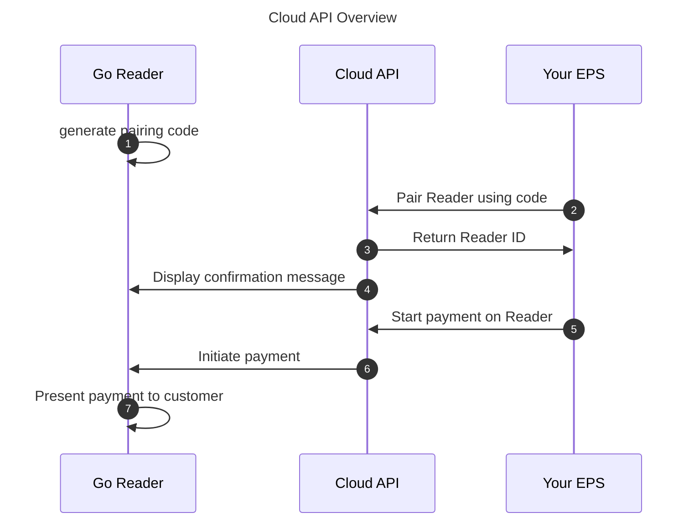

import { Steps, Tabs, TabItem } from '@astrojs/starlight/components';

The Cloud API lets you start a transaction from an external payment system (EPS) running on any platform capable of sending HTTPS requests and complete that transaction on a [Go](/terminal-payments/readers/go/) reader.

Key advantages include:

- Compatibility with any operating system and platform
- Ability to process simultaneous transactions on multiple Go readers at once
- No distance limitation between your EPS and the Go reader; transactions can be sent remotely
- No Bluetooth connection required
- PCI compliance, ensuring secure and compliant transactions

The Cloud API integration supports:

- Debit, credit, and contactless transactions
- Pairing multiple Go readers with any SumUp account
- Naming each Go reader as desired to streamline checkout
- Wi-Fi and mobile data connectivity

## Prerequisites

- Your device must be authorized to use the Cloud API. [Refer to the authorization guide](/tools/authorization/) and implement the method that best fits your use case. An API key should be sufficient if you do not plan to delegate access to third parties.
- You must [create an Affiliate Key](/tools/authorization/affiliate-keys/) for your app, as SumUp Cloud API requires this key in payment requests.
- A Go reader is available in [Australia, Mexico, and Canada](/terminal-payments/readers/go/). Examples on this page use **CAD**.

## Pairing Go Reader via Cloud API

The Cloud API acts as a bridge between your EPS and the Go reader. It supports two main processes:

- Pairing a Go reader to your account
- Taking in-person payments via Go

Once the Go reader is paired to your SumUp account, your EPS can initiate a card charge request. SumUp handles the rest, providing a seamless payment experience where all card data is encrypted end-to-end. Transaction results are available by polling the [Transactions API](/api/transactions/get).



### Generate Pairing Code

To initiate a payment on the Go reader, it must be enrolled with the merchant account. This enrollment, called reader pairing, starts on the card reader by generating a pairing code and finishes when your EPS completes a pairing request using the Cloud API with that code. Both your EPS and the Go reader must be connected to the internet (not necessarily the same network).

:::note
The pairing process has an expiration time of 5 minutes. If any issue occurs, the process must be restarted.
:::

On the Go reader, open the integrations flow and generate a pairing code. Copy the code displayed on the reader screen—you need it to pair the reader from your EPS.

### Pair the Card Reader with Pairing Code

<Steps>

1. Send a request to the [Create Reader endpoint](/api/readers/create).
2. Verify pairing confirmation on the reader screen. It appears for a short while, after which the reader returns to the idle screen.

</Steps>

## Using Paired Reader

The Cloud API lets you manage transactions and readers connected to your account.

### Initiate Transaction

Initiate a payment on a paired Go reader. Use `client_transaction_id` as an idempotency key: retrying the request with the same value returns the result of the original payment instead of creating a duplicate.

<Tabs syncKey="backend_lang">
  <TabItem label="cURL" icon="seti:powershell">
    ```bash
    curl -X POST \
      https://api.sumup.com/v0/merchants/$SUMUP_MERCHANT_CODE/readers/$READER_ID/go-checkout \
      -H "Authorization: Bearer $SUMUP_API_KEY" \
      -H 'Content-Type: application/json' \
      -d '{
            "client_transaction_id": "19e12390-72cf-4f9f-80b5-b0c8a67fa43f",
            "total_amount": {
              "currency": "CAD",
              "value": 1500
            }
          }'
    ```
  </TabItem>
  <TabItem label="JavaScript" icon="seti:javascript">
    ```ts
    const payment = await client.readers.createGoCheckout(merchantCode, readerId, {
      client_transaction_id: "19e12390-72cf-4f9f-80b5-b0c8a67fa43f",
      total_amount: {
        currency: "CAD",
        value: 1500,
      },
    });
    ```
  </TabItem>
  <TabItem label=".NET" icon="seti:c-sharp">
    ```csharp
    var payment = await client.Readers.CreateGoCheckoutAsync(
        merchantCode,
        readerId,
        new ReaderPaymentRequestParams
        {
            ClientTransactionId = "19e12390-72cf-4f9f-80b5-b0c8a67fa43f",
            TotalAmount = new Amount
            {
                Currency = "CAD",
                Value = 1500,
            },
        });
    ```
  </TabItem>
  <TabItem label="Java" icon="seti:java">
    ```java
    var payment = client.readers().createGoCheckout(
        merchantCode,
        readerId,
        ReaderPaymentRequestParams.builder()
            .clientTransactionId("19e12390-72cf-4f9f-80b5-b0c8a67fa43f")
            .totalAmount(Amount.builder()
                .currency("CAD")
                .value(1500L)
                .build())
            .build()
    );
    ```
  </TabItem>
  <TabItem label="Go" icon="seti:go">
    ```go
    payment, err := client.Readers.CreateGoCheckout(ctx, merchantCode, readerID, sumup.ReadersCreateGoCheckoutParams{
        ClientTransactionID: "19e12390-72cf-4f9f-80b5-b0c8a67fa43f",
        TotalAmount: sumup.Amount{
            Currency: "CAD",
            Value:    1500,
        },
    })
    ```
  </TabItem>
  <TabItem label="Python" icon="seti:python">
    ```py
    payment = await client.readers.create_go_checkout(
        merchant_code,
        reader_id,
        client_transaction_id="19e12390-72cf-4f9f-80b5-b0c8a67fa43f",
        total_amount={
            "currency": "CAD",
            "value": 1500,
        },
    )
    ```
  </TabItem>
  <TabItem label="Rust" icon="seti:rust">
    ```rust
    let payment = client.readers().create_go_checkout(
        &merchant_code,
        &reader_id,
        ReaderPaymentRequestParams {
            client_transaction_id: "19e12390-72cf-4f9f-80b5-b0c8a67fa43f".into(),
            total_amount: Amount {
                currency: "CAD".into(),
                value: 1_500,
            },
            affiliate: None,
            tip_amount: None,
        },
    ).await?;
    ```
  </TabItem>
</Tabs>

Important notes:

- The target device must be online, otherwise the payment request is not accepted.
- You need to send the Affiliate Key in the request.
- The response includes a `transaction_code` you can use to look up the final transaction status.

Read the [Create Go Reader Payment API endpoint documentation](/api/readers/create-go-checkout) for details on the API request, examples, and parameter descriptions.

### Tipping

Go supports tipping only when your EPS includes a `tip_amount` in the payment request. The tip is set by your system before the payment is sent to the reader—it is not entered on the Go terminal.

Include `tip_amount` as an optional field in minor units (for example, `200` for CAD 2.00). The amount charged on the reader is the sum of `total_amount.value` and `tip_amount`.

```bash
curl -X POST \
  https://api.sumup.com/v0/merchants/$SUMUP_MERCHANT_CODE/readers/$READER_ID/go-checkout \
  -H "Authorization: Bearer $SUMUP_API_KEY" \
  -H 'Content-Type: application/json' \
  -d '{
        "client_transaction_id": "19e12390-72cf-4f9f-80b5-b0c8a67fa43f",
        "total_amount": {
          "currency": "CAD",
          "value": 1500
        },
        "tip_amount": 200
      }'
```

### Receive Transaction Results

Payment processing is asynchronous. The go-checkout response confirms that the payment was accepted and returns a `transaction_code`—not that the payment succeeded. Poll the [Retrieve a transaction endpoint](/api/transactions/get) until the transaction reaches a final state.

Use either `transaction_code` from the go-checkout response or the `client_transaction_id` you supplied when initiating the payment:

<Tabs syncKey="backend_lang">
  <TabItem label="cURL" icon="seti:powershell">
    ```bash
    curl "https://api.sumup.com/v2.1/merchants/$SUMUP_MERCHANT_CODE/transactions?transaction_code=$TRANSACTION_CODE" \
      -H "Authorization: Bearer $SUMUP_API_KEY"
    ```
  </TabItem>
  <TabItem label="JavaScript" icon="seti:javascript">
    ```ts
    const transaction = await client.transactions.get(merchantCode, {
      transaction_code: transactionCode,
    });
    ```
  </TabItem>
  <TabItem label=".NET" icon="seti:c-sharp">
    ```csharp
    var transaction = await client.Transactions.GetAsync(
        merchantCode,
        new TransactionsGetParams { TransactionCode = transactionCode });
    ```
  </TabItem>
  <TabItem label="Java" icon="seti:java">
    ```java
    var transaction = client.transactions().get(
        merchantCode,
        TransactionsGetParams.builder()
            .transactionCode(transactionCode)
            .build()
    );
    ```
  </TabItem>
  <TabItem label="Go" icon="seti:go">
    ```go
    transaction, err := client.Transactions.Get(ctx, merchantCode, sumup.TransactionsGetParams{
        TransactionCode: &transactionCode,
    })
    ```
  </TabItem>
  <TabItem label="Python" icon="seti:python">
    ```py
    transaction = await client.transactions.get(
        merchant_code,
        transaction_code=transaction_code,
    )
    ```
  </TabItem>
  <TabItem label="Rust" icon="seti:rust">
    ```rust
    let transaction = client.transactions().get(
        &merchant_code,
        TransactionsGetParams {
            transaction_code: Some(transaction_code),
            ..Default::default()
        },
    ).await?;
    ```
  </TabItem>
</Tabs>

Check the `status` field on the transaction resource. A value of `SUCCESSFUL` means the payment completed; other values indicate the payment is still pending or has failed.

Use `client_transaction_id` to match the polled transaction against the payment you started—it holds the same value you sent in the go-checkout request.

### List Connected Readers

List all readers connected to your merchant account.

<Tabs syncKey="backend_lang">
  <TabItem label="cURL" icon="seti:powershell">
    ```bash
    curl https://api.sumup.com/v0.1/merchants/$SUMUP_MERCHANT_CODE/readers \
      -H "Authorization: Bearer $SUMUP_API_KEY"
    ```
  </TabItem>
  <TabItem label="JavaScript" icon="seti:javascript">
    ```ts
    const readers = await client.readers.list(merchantCode)
    ```
  </TabItem>
  <TabItem label=".NET" icon="seti:c-sharp">
    ```csharp
    var readers = await client.Readers.ListAsync(merchantCode);
    ```
  </TabItem>
  <TabItem label="Java" icon="seti:java">
    ```java
    var readers = client.readers().listReaders(merchantCode);
    ```
  </TabItem>
  <TabItem label="Go" icon="seti:go">
    ```go
    readers, err := client.Readers.List(ctx, merchantCode)
    ```
  </TabItem>
  <TabItem label="Python" icon="seti:python">
    ```py
    readers = await client.readers.list(merchant_code)
    ```
  </TabItem>
  <TabItem label="Rust" icon="seti:rust">
    ```rust
    let readers = client.readers().list(&merchant_code).await?;
    ```
  </TabItem>
</Tabs>

Read the [List API endpoint documentation](/api/readers/list) for details on the API request, examples, and parameter descriptions.

### Check Reader Pairing

Check the pairing status of a specific reader.

Read the [Retrieve a Reader endpoint documentation](/api/readers/get) for details on the API request, examples, and parameter descriptions.

### Update Reader

Update the data of a specific reader.

Check the [Update a Reader endpoint documentation](/api/readers/update) for details on the API request, examples, and parameter descriptions.

### Delete Reader

Delete a reader from the Cloud API.

Check the [Delete a Reader endpoint documentation](/api/readers/delete) for details on the API request, examples, and parameter descriptions.

## Unpairing Go Reader

Unpairing is only possible from your EPS via the Readers API. The Go reader does not expose an unpair action in its UI—it can only refresh its pairing status to detect whether it is still paired.

To unpair a reader from the merchant account:

<Steps>

1. Send a request to the [Delete a Reader endpoint](/api/readers/delete).

</Steps>

After the reader is deleted, the Go terminal detects the change the next time it refreshes its pairing status and returns to the unpaired state.

## What's Next?

- Compare with the [Solo Cloud API guide](/terminal-payments/cloud-api/) if you also support Solo readers.
- Browse [reader compatibility](/terminal-payments/readers/go/) for Go-specific device details.
