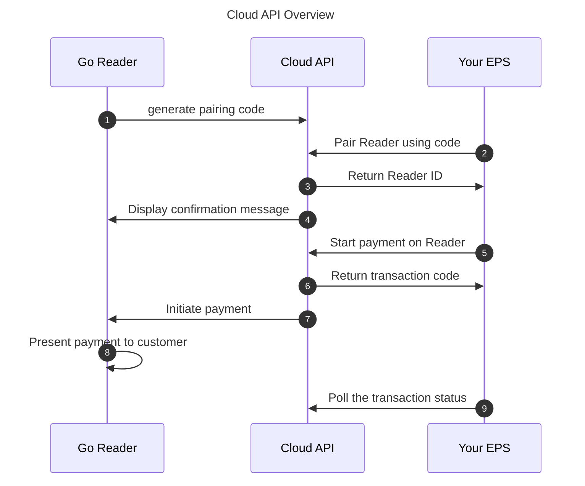

import { Steps, Tabs, TabItem } from '@astrojs/starlight/components';

The Cloud API lets you start a transaction from an external payment system (EPS) running on any platform capable of sending HTTPS requests and complete that transaction on a [Go](/terminal-payments/readers/go/) reader.

Key advantages include:

- Compatibility with any operating system and platform
- Ability to process simultaneous transactions on multiple Go readers at once
- No distance limitation between your EPS and the Go reader; transactions can be sent remotely
- No Bluetooth connection required
- PCI compliance, ensuring secure and compliant transactions

The Cloud API integration supports:

- Debit, credit, and contactless transactions
- Pairing multiple Go readers with any SumUp account
- Naming each Go reader as desired to streamline checkout
- Wi-Fi and mobile data connectivity

## Prerequisites

- Your EPS must be authorized to use the Cloud API. [Refer to the authorization guide](/tools/authorization/) and implement the method that best fits your use case. An API key should be sufficient if you do not plan to delegate access to third parties. With OAuth, request the `readers.write`, `payments`, and `transactions.history` scopes.
- We recommend keeping the Go terminals plugged in when using the Cloud API.
- A Go reader is available in [Australia, Mexico, and Canada](/terminal-payments/readers/go/). Examples on this page use **CAD**.

## Pairing Go Reader via Cloud API

The Cloud API acts as a bridge between your EPS and the Go reader. It supports two main processes:

- Pairing a Go reader to your account
- Taking in-person payments via Go

Once the Go reader is paired to your SumUp account, your EPS can initiate a card charge request. SumUp handles the rest, providing a seamless payment experience where all card data is encrypted end-to-end. Transaction results are available by polling the [Transactions API](/api/transactions/get).



### Generate Pairing Code

To initiate a payment on the Go reader, it must be enrolled with the merchant account. This enrollment, called reader pairing, starts on the card reader by generating a pairing code and finishes when your EPS completes a pairing request using the Cloud API with that code. Both your EPS and the Go reader must be connected to the internet (not necessarily the same network).

:::note
The pairing process has an expiration time of 5 minutes. If any issue occurs, the process must be restarted.
:::

To generate a pairing code on the Go reader:

<Steps>

1. On the login screen, tap the **Connections** icon.
2. Select **API** and tap **Connect**.
3. Copy the pairing code displayed on the reader screen — you need it to pair the reader from your EPS.

</Steps>

### Pair the Card Reader with Pairing Code

<Steps>

1. Send the pairing code and a name for the reader to the [Create Reader endpoint](/api/readers/create). The `id` in the response is the reader ID you use to start payments.

   ```bash
   curl -X POST \
     https://api.sumup.com/v0.1/merchants/$SUMUP_MERCHANT_CODE/readers \
     -H "Authorization: Bearer $SUMUP_API_KEY" \
     -H 'Content-Type: application/json' \
     -d '{
           "pairing_code": "4WLFDSBF",
           "name": "Frontdesk"
         }'
   ```

2. Verify pairing confirmation on the reader screen. It appears for a short while, after which the reader returns to the idle screen.

</Steps>

## Using Paired Reader

The Cloud API lets you manage transactions and readers connected to your account.

### Initiate Transaction

Initiate a payment on a paired Go reader. `client_transaction_id` is your identifier for the payment: generate a new value, such as a UUID, for every payment and store it before you send the request.

```bash
curl -X POST \
  https://api.sumup.com/v0/merchants/$SUMUP_MERCHANT_CODE/readers/$READER_ID/go-checkout \
  -H "Authorization: Bearer $SUMUP_API_KEY" \
  -H 'Content-Type: application/json' \
  -d '{
        "client_transaction_id": "19e12390-72cf-4f9f-80b5-b0c8a67fa43f",
        "total_amount": {
          "currency": "CAD",
          "value": 1500
        }
      }'
```

Important notes:

- The target device must be online, otherwise the payment request is not accepted.
- `client_transaction_id` is an idempotency key. If a request times out or fails with a network error, retry it with the same value: you get the original payment back instead of charging the customer twice.
- You can identify your integration by sending your [Affiliate Key](/tools/authorization/affiliate-keys/) in the optional `affiliate` object.
- The response includes a `transaction_code` you can use to look up the final transaction status.

Read the [Create Go Reader Payment API endpoint documentation](/api/readers/create-go-checkout) for details on the API request, examples, and parameter descriptions.

### Tipping

Go supports tipping only when your EPS includes a `tip_amount` in the payment request. The tip is set by your system before the payment is sent to the reader — it is not entered on the Go terminal.

`total_amount.value` is the amount charged on the reader, in minor units, and it already includes the tip. `tip_amount` is the portion of that total that is a tip, in the same minor units. For a CAD 15.00 sale and a CAD 2.00 tip, set `total_amount.value` to `1700` and `tip_amount` to `200`.

```bash
curl -X POST \
  https://api.sumup.com/v0/merchants/$SUMUP_MERCHANT_CODE/readers/$READER_ID/go-checkout \
  -H "Authorization: Bearer $SUMUP_API_KEY" \
  -H 'Content-Type: application/json' \
  -d '{
        "client_transaction_id": "19e12390-72cf-4f9f-80b5-b0c8a67fa43f",
        "total_amount": {
          "currency": "CAD",
          "value": 1700
        },
        "tip_amount": 200
      }'
```

### Receive Transaction Results

Payment processing is asynchronous. The go-checkout response confirms that the payment was accepted and returns a `transaction_code` — not that the payment succeeded. Poll the [Retrieve a transaction endpoint](/api/transactions/get) until the transaction reaches a final state.

Look up the transaction by the `transaction_code` from the go-checkout response:

<Tabs syncKey="backend_lang">
  <TabItem label="cURL" icon="seti:powershell">
    ```bash
    curl "https://api.sumup.com/v2.1/merchants/$SUMUP_MERCHANT_CODE/transactions?transaction_code=$TRANSACTION_CODE" \
      -H "Authorization: Bearer $SUMUP_API_KEY"
    ```
  </TabItem>
  <TabItem label="JavaScript" icon="seti:javascript">
    ```ts
    const transaction = await client.transactions.get(merchantCode, {
      transaction_code: transactionCode,
    });
    ```
  </TabItem>
  <TabItem label=".NET" icon="seti:c-sharp">
    ```csharp
    var transaction = await client.Transactions.GetAsync(
        merchantCode,
        new TransactionsGetParams { TransactionCode = transactionCode });
    ```
  </TabItem>
  <TabItem label="Java" icon="seti:java">
    ```java
    var transaction = client.transactions().get(
        merchantCode,
        TransactionsGetParams.builder()
            .transactionCode(transactionCode)
            .build()
    );
    ```
  </TabItem>
  <TabItem label="Go" icon="seti:go">
    ```go
    transaction, err := client.Transactions.Get(ctx, merchantCode, sumup.TransactionsGetParams{
        TransactionCode: &transactionCode,
    })
    ```
  </TabItem>
  <TabItem label="Python" icon="seti:python">
    ```py
    transaction = await client.transactions.get(
        merchant_code,
        transaction_code=transaction_code,
    )
    ```
  </TabItem>
  <TabItem label="Rust" icon="seti:rust">
    ```rust
    let transaction = client.transactions().get(
        &merchant_code,
        TransactionsGetParams {
            transaction_code: Some(transaction_code),
            ..Default::default()
        },
    ).await?;
    ```
  </TabItem>
</Tabs>

Alternatively, pass the `client_transaction_id` you sent in the go-checkout request:

```bash
curl "https://api.sumup.com/v2.1/merchants/$SUMUP_MERCHANT_CODE/transactions?client_transaction_id=$CLIENT_TRANSACTION_ID" \
  -H "Authorization: Bearer $SUMUP_API_KEY"
```

Check the `status` field on the transaction resource. `SUCCESSFUL` means the payment completed, `FAILED` and `CANCELLED` are final, and `PENDING` means the customer has not finished the payment yet.

The transaction may not be available immediately after the go-checkout request. If the lookup returns `404 Not Found`, keep polling — it does not mean the payment failed. Poll at a fixed interval, such as every 2 seconds, rather than in a tight loop.

### List Connected Readers

List all readers connected to your merchant account.

<Tabs syncKey="backend_lang">
  <TabItem label="cURL" icon="seti:powershell">
    ```bash
    curl https://api.sumup.com/v0.1/merchants/$SUMUP_MERCHANT_CODE/readers \
      -H "Authorization: Bearer $SUMUP_API_KEY"
    ```
  </TabItem>
  <TabItem label="JavaScript" icon="seti:javascript">
    ```ts
    const readers = await client.readers.list(merchantCode)
    ```
  </TabItem>
  <TabItem label=".NET" icon="seti:c-sharp">
    ```csharp
    var readers = await client.Readers.ListAsync(merchantCode);
    ```
  </TabItem>
  <TabItem label="Java" icon="seti:java">
    ```java
    var readers = client.readers().listReaders(merchantCode);
    ```
  </TabItem>
  <TabItem label="Go" icon="seti:go">
    ```go
    readers, err := client.Readers.List(ctx, merchantCode)
    ```
  </TabItem>
  <TabItem label="Python" icon="seti:python">
    ```py
    readers = await client.readers.list(merchant_code)
    ```
  </TabItem>
  <TabItem label="Rust" icon="seti:rust">
    ```rust
    let readers = client.readers().list(&merchant_code).await?;
    ```
  </TabItem>
</Tabs>

Read the [List API endpoint documentation](/api/readers/list) for details on the API request, examples, and parameter descriptions.

## Unpairing Go Reader

Unpairing is only possible from your EPS via the Readers API. The Go reader does not expose an unpair action in its UI — it can only refresh its pairing status to detect whether it is still paired.

To unpair a reader from the merchant account:

<Steps>

1. Send a request to the [Delete a Reader endpoint](/api/readers/delete).
2. On the Go reader, tap the refresh icon to update the pairing status. The reader returns to the unpaired state.

</Steps>

## What's Next?

- Compare with the [Solo Cloud API guide](/terminal-payments/cloud-api/) if you also support Solo readers.
- Browse [reader compatibility](/terminal-payments/readers/go/) for Go-specific device details.
