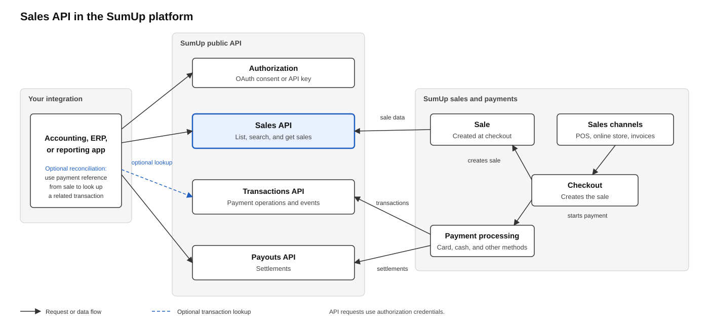

The Sales API lets your integration read a merchant’s sales. Use it to bring sales data into accounting, ERP, and reporting systems.

This guide explains how the Sales API fits into the SumUp platform and suggests patterns for building a reliable integration. For endpoint parameters, response fields, and schemas, see the [Sales API reference](https://developer.sumup.com/api/tags/sales/).

## Choose the Right API

The Sales API and [Transactions API](https://developer.sumup.com/api/tags/transactions/) describe related data at different levels.

| If you need to… | Use… |
| --- | --- |
| See what was sold, including items, prices, discounts, and taxes | Sales API |
| Retrieve a sale using its sale ID | Sales API |
| Inspect a payment’s outcome and event history | Transactions API |
| Issue a refund | Transactions API |
| Investigate payouts and settlement activity | Transactions API and Payouts API |



Use the Sales API for the **business view** of a sale. A sale object is created **at sucessfully processed checkout**. The diagram shows how checkout, sale data, payment processing, and the public APIs relate. Note that only fully paid sales are returned by the Sales API. Use the Transactions API for the **payment view**. If you need both, retrieve the sale first, then use its payment reference to look for a related transaction. Check the [Transactions API reference](https://developer.sumup.com/api/tags/transactions/) for the current lookup options.

## Out of Scope

* Sales API is read-only, no write operations are available.
* Sales API does not support multi-merchant operations.
* Sales API does not provide webhooks nor async event support.

## Get Access

### Authenticate Requests

Send an access token in the `Authorization` header as a bearer token. Merchant API key and OAuth are both valid options. For OAuth, request the `sales.read` scope. Requests also require the `merchant_read` permission. See the [authorization guide](https://developer.sumup.com/tools/authorization/) and the [Sales API reference](https://developer.sumup.com/api/tags/sales/).

Use the merchant code for the account associated with the token. Request only the access your integration needs.

### Send a User-Agent Header

Include a non-empty `User-Agent` header with every request. A missing or empty value returns `412`. Identify your integration with a product name and version, such as `acme-bookkeeping-sync/1.4.0`.

## Make a First Request

This example searches for sales created on a specific day. Replace the placeholders with your merchant code, token, and integration name.

```bash
curl --request POST \
  --url https://api.sumup.com/v1.0/merchants/<MERCHANT_CODE>/sales/search \
  --header "Authorization: Bearer <ACCESS_TOKEN>" \
  --header "Content-Type: application/json" \
  --header "User-Agent: <YOUR_INTEGRATION>/<VERSION>" \
  --data '{
    "start_date": "2026-06-01T00:00:00Z",
    "end_date": "2026-06-01T23:59:59Z",
    "sale_statuses": ["CLOSED"],
    "payment_statuses": ["PAID"],
    "pagination_limit": 25
  }'
```

Search returns summary rows. To retrieve the items and other details for a sale, use its `id` with the [Get a sale](https://developer.sumup.com/api/sales/get-sale-v10/) operation.

## Choose an Operation

| Goal | Operation | Notes |
| --- | --- | --- |
| List recent sales without filters | [`GET /v1.0/merchants/{merchant_code}/sales`](https://developer.sumup.com/api/sales/list-sales-v10/) | Results are ordered newest first. |
| Find sales within a date range or by status or channel | [`POST /v1.0/merchants/{merchant_code}/sales/search`](https://developer.sumup.com/api/sales/search-sales-v10/) | Results are ordered by sale close date, newest first. |
| Retrieve one sale | [`GET /v1.0/merchants/{merchant_code}/sales/{sale_id}`](https://developer.sumup.com/api/sales/get-sale-v10/) | Use the sale ID from a list or search result. |

Use search for a scheduled sync that needs a date window or filters. Use list when you need to browse recent results without filters.

## Build a Reliable Sync

The API does not provide webhooks for sale changes. Poll it on a schedule and make each run safe to repeat.

### Use an Overlapping Time Window

The search date filters apply to when the sale was created. Results are ordered by sale close date. A sale created before your current window can appear in that window’s ordering after it closes.

A sale is created at checkout. Because creation time and close-date ordering are different, use an overlapping window rather than treating the last result’s close time as the next search start time.

A practical sync pattern is:

1. Save the time window of the last successful run.
2. Start the next run before the previous window ended. Choose an overlap that fits your data-latency and reconciliation needs.
3. Search with the same date and status filters for every page in the run.
4. Follow pagination tokens until there are no more results.
5. Retrieve each sale’s details when your integration needs them.
6. Store or update the sale using its `id` as the key.
7. Re-read recent windows on later runs to detect changes to sales you have already stored.

The API covers the merchant’s sales from the last two years. Narrow the results with date filters as needed. See the [Search sales reference](https://developer.sumup.com/api/sales/search-sales-v10/) for the supported date range and filters.

### Follow Pagination Tokens

Treat each pagination token as an opaque value. Pass it to the same operation that returned it; list and search tokens are not interchangeable. Keep the filters unchanged while paging through one search.

The search operation supports a page size of up to 25. Check the [Search sales reference](https://developer.sumup.com/api/sales/search-sales-v10/) for the current limits and request format.

### Make Retries Safe

A request can fail after your integration has processed some results. Store records by sale ID and use upserts so that rerunning the same window does not create duplicates.

The API does not determine how long after a sale’s creation its payment details can change. If your reconciliation needs to detect later changes, decide how far back to re-read sales and document that policy in your integration.

## Understand Sale Status

{/* TODO clarify this further. Do we want to discuss other status changes here and their logic? It confuses me a bit that we have a sale status filter with one value. */}

Only fully paid sales are returned by the API.

The search filter also supports `PAID` and `CHARGED_BACK` as payment-status values. Use the [Search sales reference](https://developer.sumup.com/api/sales/search-sales-v10/) for the accepted values and their current descriptions.

## Read Sale Content

### Handle Line Items

A sale can contain different kinds of lines. Use the shared fields described in the [Sale schema](https://developer.sumup.com/api/schemas/Sale/) to display and process a line.

Treat item types as extensible. New types or feature names can be added, so handle values your integration does not recognize without failing the entire sale. Read optional feature data only when it is present.

### Distinguish Sale Fees from Payment Costs

Merchant-charged fees, such as shipping or service charges, are represented as sale lines. They contribute to the sale total. Payment processing costs are separate from those sale charges.

See the [Sale schema](https://developer.sumup.com/api/schemas/Sale/) for the line and feature details.

### Account for Discounts and Tax

Discounts can apply to an item or to the cart. Compare final amounts when reconciling sale totals; standard amounts may not include discounts.

Use the sale’s tax mode and the tax breakdown in the response when reconciling tax. The [Sale schema](https://developer.sumup.com/api/schemas/Sale/) describes the relevant fields.

## Work with Amounts and Payments

### Parse Money Safely

Sale responses use currency-aware amounts. Depending on the field, an amount may be an integer in minor units or an object containing a currency and value. Check the field’s schema before parsing it.

Use the currency scale when converting minor units to major units. Store amounts as integers or decimals rather than floating-point values. Return-like lines can have negative amounts.

### Reconcile Sale Totals with Payments

A sale total and a payment amount may not be equal. The search response describes its total as excluding tips, while payment amounts include tips. Check the [Sale schema](https://developer.sumup.com/api/schemas/Sale/) and [Payment schema](https://developer.sumup.com/api/schemas/PublicPaymentV10/) for the current fields; do not infer a tip amount from the difference unless the response provides the information needed.

The payment `reference` is described as a reference to the payment used for the sale, for example a SumUp transaction code. Treat it as a possible correlation value, not as a guaranteed unique join, until you have verified how it maps to the Transactions API in your integration.

{/* TODO clarify this - do we have cases where it's not the transaction code? */}

## Handle Errors

The API uses standard HTTP status codes and Problem Details responses. See the [API errors guide](https://developer.sumup.com/tools/errors/) for the error format.

Common checks:

* For `401`, check that the authorization header contains a valid token.
* For `403`, check the scope, permission, and merchant code.
* For `412`, add a non-empty `User-Agent` header.
* For other errors, use the response details and the operation-specific reference to correct the request before retrying.

For transient server errors, use a bounded retry policy with backoff. Do not retry an invalid request unchanged.

## Prepare for API Changes

Build your integration to tolerate additive changes:

* Ignore response fields that your integration does not use.
* Handle unknown item types and feature names without failing the sale.
* Check the [SumUp changelog](https://developer.sumup.com/changelog/) for API changes that may affect your integration.

## Protect Merchant Data

* Request only the access your integration needs.
* Store access tokens securely. Do not include them in logs or error reports.
* Keep only the sale data needed for your use case and define an appropriate retention period.
* Keep records for different merchants separate.
